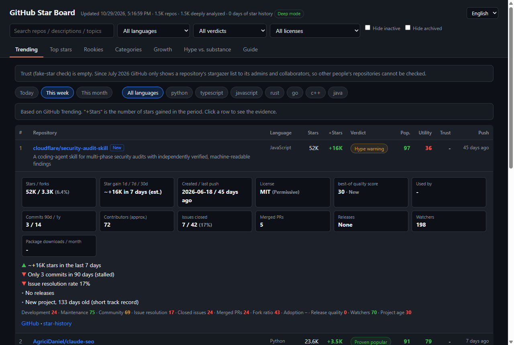

# GitHub Star Board

**Stars tell you what's popular. Star Board tells you what's actually used.**

A daily, fully automated GitHub ranking that checks every trending and top-starred repository against real-usage evidence: commits, contributors, issue resolution, releases, package downloads and GitHub "Used by" counts. Built for humans *and* AI agents.

**Live board: https://kiddongwook.github.io/star-board/** · [llms.txt](https://kiddongwook.github.io/star-board/llms.txt) · [Daily summary](https://kiddongwook.github.io/star-board/api/summary.md)



## Why

Star counts are easy to inflate and say nothing about whether a project is maintained or used. Since July 2026 GitHub also hides stargazer lists from non-collaborators, so you can't inspect who starred a repo anymore. Star Board looks at what stars can't fake:

| Signal | Source |
|-|-|
| Development activity | commits in the last 90 days / 1 year |
| Community | contributors, merged PRs, issue resolution rate |
| Real adoption | npm / PyPI / crates.io monthly downloads, GitHub "Used by" |
| Release quality | multiple releases, stable semver, released in the last 6 months |
| Health labels | new (< 6 months), inactive (6 months idle), abandoned (12 months idle) |
| License risk | permissive / weak copyleft / copyleft / non-standard / none |

Each repository gets a **popularity** score, a **utility** score, a [best-of-lists](https://github.com/best-of-lists/best-of-generator)-style **quality** score and a verdict: *Proven popular*, *Hidden gem*, *Mature*, *Hype warning*, *Learning / docs*, *Abandoned*.

## What's on the board

- **Trending**: GitHub Trending (today / week / month, by language) with stars gained
- **Top stars**: all-time Top 200 plus Top 50 per language
- **Rookies**: repos created in the last 7 / 30 days, ranked by stars per day
- **Categories**: AI coding agents, AI agent frameworks, MCP, LLM inference, RAG, dev tools, self-hosted, security, biometrics, computer vision, embedded/IoT
- **Growth**: measured star gains and utility score changes from daily snapshots
- **Hype vs. substance**: popularity x utility map with hidden gems and hype warnings
- **Per-repo pages**: `/r/{owner}/{repo}/` with evidence, metrics, a "Copy for AI" block and a badge
- **Languages**: English, 한국어, 日本語, 中文 (follows your browser setting)

## For AI agents and LLMs

Everything is published as plain files, regenerated daily:

| File | Use |
|-|-|
| [`llms.txt`](https://kiddongwook.github.io/star-board/llms.txt) | Index: which file answers which question, field meanings |
| [`api/summary.md`](https://kiddongwook.github.io/star-board/api/summary.md) | ~20 KB digest: trending, rookies, proven, hidden gems, hype, per category |
| [`api/index.json`](https://kiddongwook.github.io/star-board/api/index.json) | Every repo in one table (`fields` + `rows`) |
| `api/repo/{owner}__{repo}.json` | Full evidence for one repository |
| `api/trending.json`, `api/top.json`, `api/rookies.json`, `api/category/*.json` | Lists per tab |

## Use it from your AI agent

### MCP server

No install, no API key. Add this to Claude Desktop, Cursor, VS Code or any MCP client:

```json
{
  "mcpServers": {
    "github-star-board": { "command": "npx", "args": ["-y", "github:kiddongwook/star-board"] }
  }
}
```

Claude Code: `claude mcp add github-star-board -- npx -y github:kiddongwook/star-board`

| Tool | What it does |
|-|-|
| `get_repo` | Verdict, scores and evidence for one repository |
| `search_repos` | Filter by language, license kind, verdict, minimum utility or stars |
| `trending` | GitHub Trending by period and language, with verdicts |
| `category` | Categories, or the repositories in one (mcp, llm, rag, coding-agent, ...) |
| `compare` | 2-6 repositories side by side |
| `summary` | Today's digest |

### Agent skill

For Claude Code, Codex, Cursor and other agents that support skills:

```bash
npx skills add kiddongwook/star-board
```

The skill (`skills/github-star-board/SKILL.md`) tells your agent to check the board's files before searching GitHub.

## Badge for your README

If your project is on the board, show its verdict:

```markdown
[](https://kiddongwook.github.io/star-board/r/OWNER/REPO/)
```

Each repo page has a ready-to-copy badge snippet.

## Run your own board

This repository is a template. Click **Use this template**, then:

1. **Settings > Pages > Source**: select **GitHub Actions**.
2. **Actions > Collect & Deploy Star Board > Run workflow**.
3. Your board appears at `https://<you>.github.io/<repo>/` and updates every day at 21:00 UTC.

No token setup is needed; the workflow uses the built-in `GITHUB_TOKEN`. Edit `DEFAULT_CONFIG` at the top of `collect.mjs` (or add a `config.json`) to change languages, categories and limits. Run locally with `GITHUB_TOKEN=... node collect.mjs` (Node 20+, no dependencies).

## Daily change alerts

Each run writes `data/changes.md` (surges, new entries, score changes) and publishes it as a GitHub Release. **Watch > Custom > Releases** to get it every morning.

## Limits

- Coverage: trending, top-starred, new and the configured topics. Small niche projects may be missing.
- Used by is scraped for the top 400 repos; downloads are found only when a root manifest names the package.
- Fake-star detection by sampling stargazers is not possible since GitHub's July 2026 restriction; look for mismatches instead (huge star growth, few commits/contributors/downloads).
- Scores are heuristics. Check license texts yourself before commercial use.

## 한국어

GitHub 스타 순위표 + 실효성 검증 대시보드입니다. 매일 자동으로 Trending, 누적 스타 순위, 신규 저장소, 분야별 저장소를 모으고 커밋, 참여자, 이슈 해결률, 릴리스, 다운로드, Used by로 "진짜 쓰이는지"를 판정합니다. 대시보드는 브라우저 언어를 따라 한국어로 표시되며, AI가 읽을 수 있는 `llms.txt`와 `api/` 파일을 함께 제공합니다. 이 저장소를 템플릿으로 자신만의 보드를 만들 수도 있습니다.

## License

MIT. If this saves you from a hyped dependency, a ⭐ helps others find it.
